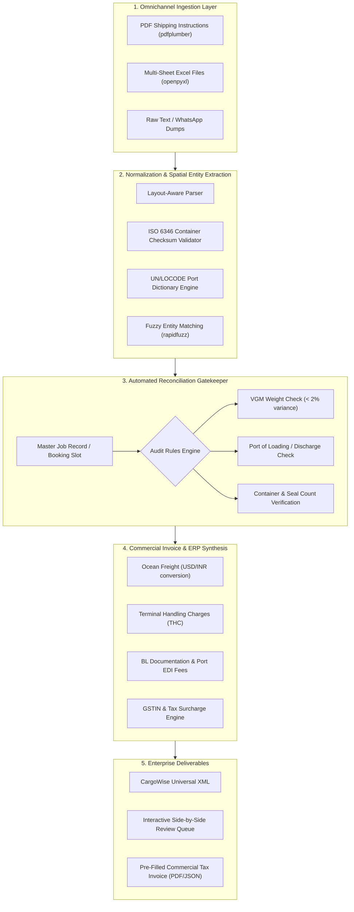

# System Architecture Specification: DahNAY FreightFlow Engine

**Target Enterprise:** DahNAY Logistics (Chennai HQ, Mumbai, Tuticorin & Global Branches)  
**System Name:** DahNAY FreightFlow Engine (Enterprise Edition)  
**Version:** 2.4.0-PROD  

---

## 1. Documented Enterprise Problem Statement

DahNAY Logistics is a premier Indian multimodal freight forwarding and logistics conglomerate. In its high-volume EXIM operations:
* Operational bottlenecks arise primarily from **manual documentation, invoicing errors, and gaps in interdepartmental coordination**.
* Inbound Shipping Instructions (SI) from hundreds of exporters arrive in non-standard formats (scanned PDFs, multi-tab Excel files, emails, and WhatsApp images).
* Documentation staff manually cross-check these inputs against carrier booking confirmations and type them into CargoWise One / Logisys ERP to generate draft Bills of Lading and Commercial Invoices.
* Even an **8% human error rate** (VGM weight mismatches, spelling errors in consignee entities, or wrong port codes) results in:
  - Carrier Bill of Lading amendment penalties ($50–$150 USD per amendment).
  - Terminal gate-in shut-outs due to weight discrepancies exceeding SOLAS VGM tolerances.
  - Cash flow delays caused by invoice disputes between shipper and freight forwarder.

---

## 2. End-to-End System Architecture



---

## 3. Mathematical Validation Formulations

### A. ISO 6346 Container Code Checksum Verification
Every intermodal shipping container code (e.g. `MSCU9081245`) consists of:
1. Owner code: 3 letters (`MSC`)
2. Equipment identifier: 1 letter (`U` for freight container)
3. Serial number: 6 digits (`908124`)
4. Check digit: 1 digit (`5`)

The check digit must satisfy:
$$\text{Check Digit} = \left( \sum_{i=0}^{9} V(c_i) \cdot 2^i \right) \pmod{11} \pmod{10}$$
where $V(c_i)$ maps letters $A \to 10, B \to 12, \dots$ (skipping multiples of 11).
FreightFlow automatically computes this checksum; if a character was misread by OCR (e.g. `0` vs `O`), the system flags the exact single-character error.

### B. SOLAS Verified Gross Mass (VGM) Discrepancy Tolerance
The International Maritime Organization (IMO) SOLAS treaty mandates that container gross weight cannot deviate from certified VGM:
$$\Delta W = |W_{\text{SI}} - W_{\text{Booking}}|$$
$$\text{Status} = \begin{cases} 
\text{MATCHED}, & \Delta W \le 50\text{ kg} \\
\text{WARNING (VGM Update Req.)}, & 50\text{ kg} < \Delta W \le 500\text{ kg} \\
\text{CRITICAL REJECT (Shut-Out Risk)}, & \Delta W > 500\text{ kg}
\end{cases}$$

---

## 4. ERP Integration Schema: CargoWise Universal XML

To ensure 100% zero-friction onboarding at DahNAY, FreightFlow outputs natively compliant **UniversalShipment XML** recognized by CargoWise One:

```xml
<UniversalShipment xmlns="http://www.cargowise.com/Schemas/Universal/2011/11">
  <Shipment>
    <DataContext>
      <Company>DAHNAY_LOGISTICS_CHENNAI</Company>
      <EnterpriseID>DAHNAY</EnterpriseID>
      <ServerID>PROD</ServerID>
    </DataContext>
    <Order>
      <OrderNumber>BKG-MAA-992104</OrderNumber>
      <TransportLeg>
        <PortOfLoading>INMAA</PortOfLoading>
        <PortOfDischarge>AEJEA</PortOfDischarge>
        <VesselName>MSC EMANUELA</VesselName>
        <VoyageNumber>2408W</VoyageNumber>
      </TransportLeg>
      <!-- Container and Invoice lines dynamically populated -->
    </Order>
  </Shipment>
</UniversalShipment>
```
